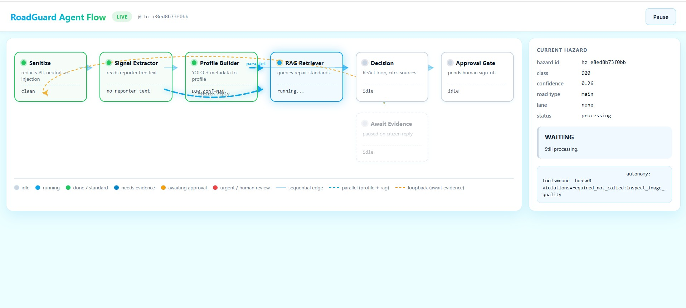
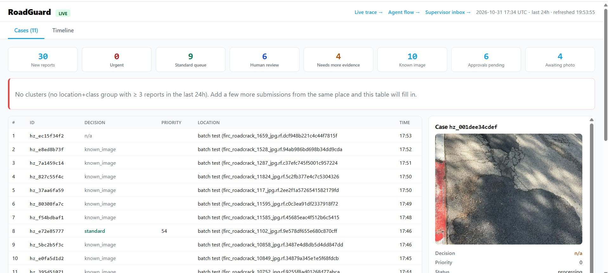
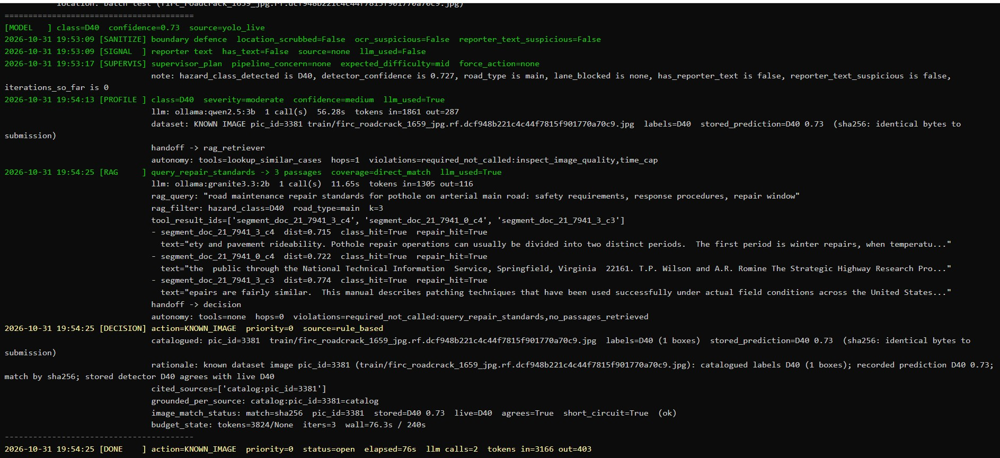
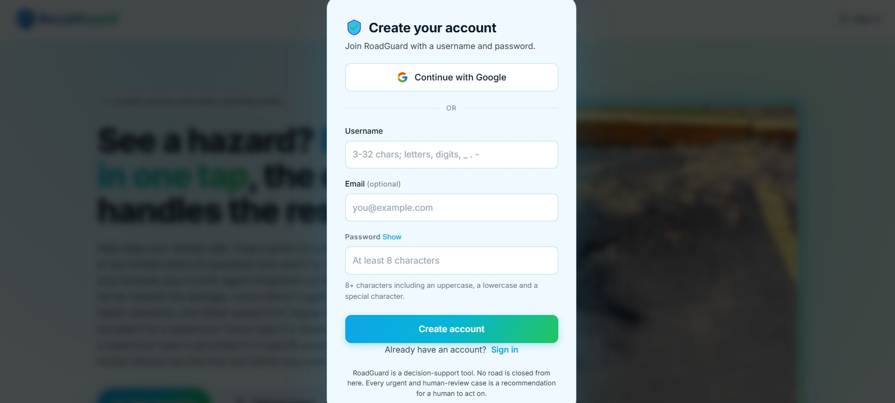
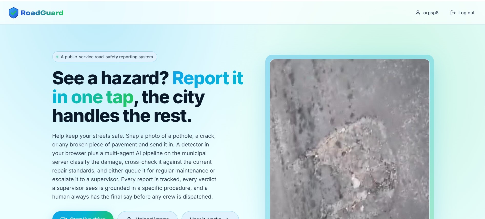

# RoadGuard

**Live site: https://orarr2.github.io/RoadGuard/**

Status: delivered end-to-end on the Agent track. Last agent-layer
update 2026-10-31 (worker autonomy behind `AGENT_WORKER_AUTONOMY`,
agent_notes memory, queue management, evidence-based RAG grading,
KNOWN_IMAGE gate, policy-driven thresholds). The audit log with the
status of every item is `docs/agent-architecture-audit-2026-10-31.md`.

Road-damage triage for a smart city. A citizen photographs road damage with a
phone; YOLOv8n detects the four RDD2022 classes (D00 longitudinal cracks, D10
transverse cracks, D20 alligator cracking, D40 potholes) inside the browser; the
agent layer on the server recommends one of four actions - `urgent`, `standard`,
`needs_more_evidence`, `human_review` - with a priority and a rationale grounded in
the municipal repair standards. Nothing closes a road or dispatches a contractor:
every `urgent` or `human_review` verdict waits for a human on the approval page.

## Screenshots











## Layout

```
roadguard_agent.py   the agent core: settings, auth helpers, SQLite layer, the
                     LangGraph pipeline (supervisor, signal_extractor,
                     profile_builder, rag_retriever, the Decision agent, approval
                     gate, evidence pause), its tools, prompts, the approval e-mail
                     and the trace formatter. One module; "# section:" comments
                     mark the former modules
roadguard_api.py     the FastAPI service: login, hazard submission (sync, async,
                     live), reports, approvals, evidence requests, the private
                     operator pages (/trace, /supervisor, /status) and the
                     retention sweep. Imports roadguard_agent
policy.yaml          thresholds and triggers the agent reads (single source of truth)
data/mini_corpus.jsonl   15 seed passages for the RAG index (replaced by the real corpus)
webapp/              the citizen webapp served by GitHub Pages (detection in the
                     browser with onnxruntime-web, upload or live drive, async
                     submit and poll, evidence round trip, history)
tests/               conftest.py, test_eval_scenarios.py, the 73-scenario synthetic
                     eval set plus tests/labeled_scenarios.json (27 labelled cases,
                     100 in all), and the unit tests for the agents, queues and API
deploy/              setup.sh, roadguard.service and README for a Linux VM (gitignored,
                     reveals the Oracle A1.Flex layout - see your local checkout)
scripts/export_yolo.py       .pt -> .onnx for the webapp detector
scripts/rag_truth_test.py    canary insert / query / delete / query to prove the RAG retriever is
                             wired to the live ChromaDB collection and not a static map (reviewer P0)
scripts/rg-digest            twice-daily digest + PDF generator; installed at /usr/local/bin on
                             the VM, fires at 05:00 and 17:00 UTC under the roadguard cron
scripts/catalog_dataset.py   builds the SQLite dataset catalogue used by lookup_dataset_image
scripts/predict_catalog_with_shai_model.py   scores every catalogue image with the team's ONNX
                             model through the notebook's own predict_paths (feeds --predictions)
scripts/agent_eval.py        per-agent evaluation over the labelled + synthetic scenarios
scripts/rag_relevance_eval.py   16-pair (class x road) RAG relevance check, 95% target
docs/                agents-architecture.md (authoritative), agents-contract.md,
                     agent-architecture-audit-2026-10-31.md (item-by-item status),
                     team-meeting/ (meeting handout, requirements sheet, deck)
.github/workflows/pages.yml   webapp -> GitHub Pages
```

## Run it

```bash
python -m venv .venv
# Windows: .venv\Scripts\activate      POSIX: source .venv/bin/activate
pip install -r requirements.txt
cp .env.example .env                 # then set ROADGUARD_JWT_SECRET, ROADGUARD_PASSPHRASE_HASH, ...
uvicorn roadguard_api:app --host 0.0.0.0 --port 8000
```

The RAG index is seeded once from the corpus file:

```bash
python -c "from roadguard_agent import seed_from_jsonl; print(seed_from_jsonl('data/mini_corpus.jsonl'))"
```

Tests (offline, no model needed):

```bash
pip install -r requirements-dev.txt
pytest -q
```

## The agent layer

A LangGraph `StateGraph` with a Python supervisor that routes
`sanitize -> signal_extractor -> profile_builder -> rag_retriever -> decision ->
approval_gate`, with `await_evidence` as a checkpointed pause when the agent asks
the reporter for one more piece of evidence.

| Node | What it does | LLM | Tools (least privilege) | May write |
|---|---|---|---|---|
| sanitize | regex boundary defence on the location, OCR text and reporter text | no | - | - |
| signal_extractor | reporter free text -> structured signals | yes, JSON with a regex fallback | extract_measurements, lookup_prior_reports (read) | - |
| supervisor | Python router; four budget caps (iterations, tool hops, cost, wall clock) | no | - | - |
| profile_builder | YOLO + image quality + metadata -> hazard profile | yes, may only lower confidence | lookup_similar_cases, inspect_image_quality, recall_agent_notes (read) | - |
| rag_retriever | ChromaDB lookup of repair standards; passages neutralised first | yes, labels coverage | query_repair_standards, broaden_rag_query, recall_agent_notes (read) | - |
| decision | ReAct loop (max 2 tool hops): action, priority, inspector-prose rationale, citations | yes, inspector persona | 7 tools: 4 action + 3 read-only, plus recall_agent_notes (see below) | evidence request, DRAFT work order, approval row |
| approval_gate | pending approval row + signed link | no | - | approvals |
| await_evidence | pauses on a checkpoint until the reporter answers | no | - | - |

With `AGENT_WORKER_AUTONOMY=0` (the default) only Decision is an agent in the
strict sense (the model chooses its next step); the other LLM-backed nodes are
workers whose next step the code fixes. With the flag on (the Oracle deployment
since 2026-10-31) the three workers get an information gap instead of
pre-computed answers, must fetch what they need through their tools, declare
`tools_used` in their reply, and are verified against the tools' own results
(declared vs. run, regex-confirmed numbers, quality tool required, research
handoff built from the agent's own retrieval); hops default to 3 and
`latency.worker_time_cap_s` bounds each worker. Supervisor decisions are stored
as lessons (`agent_notes`) that perception, research and Decision can recall.
Section 14 of `docs/agent-architecture-audit-2026-10-31.md` has the contract.

**Decision tools** (what the LLM can call mid-ReAct):

- `check_hazard_severity`, `request_additional_evidence`, `create_draft_work_order`, `flag_for_urgent_review` - the original action tools.
- `lookup_dataset_image` - exact phash hit in the RDD2022 catalogue; known_image fast path.
- `rank_similarity_to_catalog` - top-K near matches with a similarity % (distance 0 = 100%, distance 24 = 62%). Lets the agent say "looks ~82% like catalogued D40 pic_id=1024" instead of a binary known / new.
- `check_recent_cluster` - count of same-class reports at the same free-text location in the window; returns `cluster_flag` = none / emerging / strong, so recurring issues get flagged instead of triaged as one-offs.
- `recall_agent_notes` (only with `AGENT_WORKER_AUTONOMY=1`) - lessons from past supervisor decisions on the same class and road type; hints, never rules.
- `check_system_health` (ollama ps + /proc/meminfo) backs `GET /health/system` and is no longer offered to the model: in the 27.10 batch it cost a tool hop in six runs and never changed a verdict.

**Guardrails** (what the LLM does NOT decide):

- Human approval before any urgent or human-review case moves on.
- Deterministic floors kept only where they correct the LLM, not pre-empt it: the rule tree's `known_image`, `human_review` on suspicious OCR / sanitize hits, `human_review` on a catalog-vs-detector contradiction (catalog says D20 but the detector reports D40 at confidence >= 0.30 - the mismatch has to reach a supervisor, not get hidden behind a priority-0 `known_image`), and the policy's `urgent` preconditions. The old zero-conf and `confidence<0.5` floors were removed - the Decision persona reads those signals in context and decides.
- Grounding check: `cited_sources` must be a subset of the retriever's `tool_result_ids`, otherwise the rule tree decides.
- Boundary defence on all free text: injection patterns neutralised, reporter text wrapped in `[USER_SUPPLIED_UNVERIFIED]` markers so downstream prompts treat it as evidence not instructions, PII redacted (phone / email / national id / IBAN / card) before the row is stored or shown.
- Signal extractor emits `jurisdiction_hint` for non-Israeli submissions so the Decision agent can route them to a human instead of into the normal urgent / standard queue.
- Profile builder appends bbox-level sanity notes (tiny area, extreme aspect, bbox hugs frame edge) to `quality_warnings`; Decision prompt tells the LLM to downweight the detector call when they appear.
- Budget caps on iterations, tool hops, cost and wall clock.
- One evidence request per hazard.

Every LLM call runs on a local Ollama model. Per-worker assignment:
`AGENT_SIGNAL_LLM` / `AGENT_PERCEPTION_LLM` / `AGENT_RESEARCH_LLM` / `AGENT_LLM_PROVIDER` (Decision) - production currently runs qwen2.5:3b on Decision after an own-measurement swap from 7b that cut per-case latency 3-5x on this ARM host. `AGENT_LLM_PANEL` can vote when `AGENT_DECISION_REACT=0`. Groq, Gemini and Mistral remain available as providers.

## API

`GET /health`, `POST /auth/login`, `GET /auth/me`, `POST /hazards/submit-async`
(202, then poll `GET /report/{hazard_id}`), `POST /hazards/submit`,
`POST /hazards/live`, `GET /hazards/history`, `GET /hazards/{id}`, `GET /report`,
`GET /report/{id}` (verdict, timeline, cited sources, the trace and its terminal
lines), `GET /approvals/{id}`, `POST /approvals/{id}/decide`,
`GET /evidence_requests`, `POST /evidence_requests/{id}/fulfill`.

Operator pages, served only on the hosts listed in `ROADGUARD_PRIVATE_HOSTS`
(loopback by default): `/trace` (a terminal that follows the newest hazard and
prints each node's decision as it happens), `/flow` (the pipeline diagram,
lit only while a run is in progress), `/supervisor` (pending approvals by
priority then age, overdue badge past `queues.approval_sla_hours`),
`GET /status` (host load, models, RAG, database with overdue approvals,
images, tunnel, shortcuts, open items), `GET /stats/agents` (per-agent
counters, LLM fallback causes, fast-path skips, autonomy tool calls and
contract violations), `POST /sql` (SELECT-only console),
`/digest/latest` (two-tab console: Cases with KPI strip + red-bordered Clusters
panel + split image/detail view; Timeline accordion), `/digest/{YYYY-MM-DD}`
(archived snapshot from the twice-daily cron), `/health/system` (ollama RAM,
loaded models, stub-mode, host memory used %), `/stats/public` (aggregates for
the public landing: open cases, closed this week, by decision, by class,
median resolution hours).

The twice-daily digest is written to `/var/lib/roadguard/digests/<date>.html`
and - when the `RG_DIGEST_SMTP_*` env vars are set - emailed to
`RG_DIGEST_MAIL_TO` via Gmail SMTP; see `deploy/README.md`.

## Deployment used by the project

Oracle Cloud `VM.Standard.A1.Flex` (4 OCPU ARM, 24 GB, Always Free), Ubuntu
24.04, `roadguard.service` (uvicorn), Ollama in Docker with the local models,
ChromaDB and SQLite on the VM, a Cloudflare tunnel for the public API, Tailscale
plus Caddy for the private operator pages, GitHub Pages for the webapp. See
`deploy/README.md`.

## Team integration points

- Detector weights: `webapp/assets/models/yolov8n-roadguard.onnx`, class order
  D00, D10, D20, D40 (`webapp/assets/config.js`); export with `scripts/export_yolo.py`.
- Labelled scenarios: `tests/labeled_scenarios.json`, same schema as
  `tests/multiagent_eval_scenarios.json`; the eval picks it up automatically.
- Repair-standard corpus: replace `data/mini_corpus.jsonl` and seed it (above).

## License

MIT. See [LICENSE](LICENSE).
